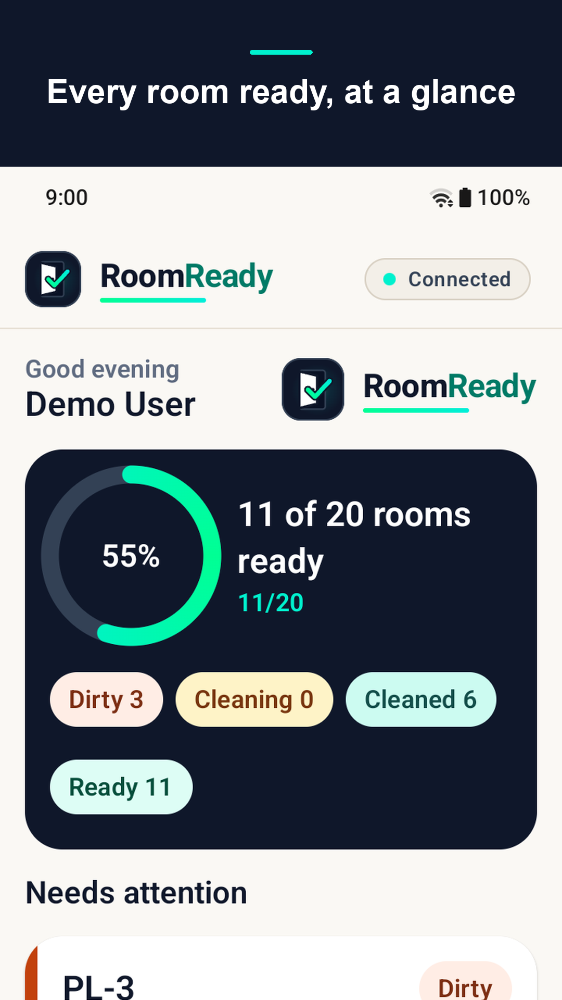
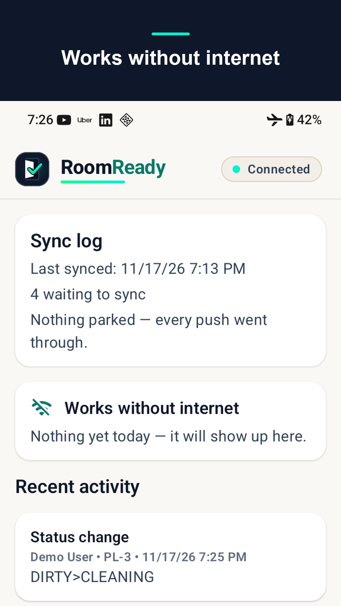
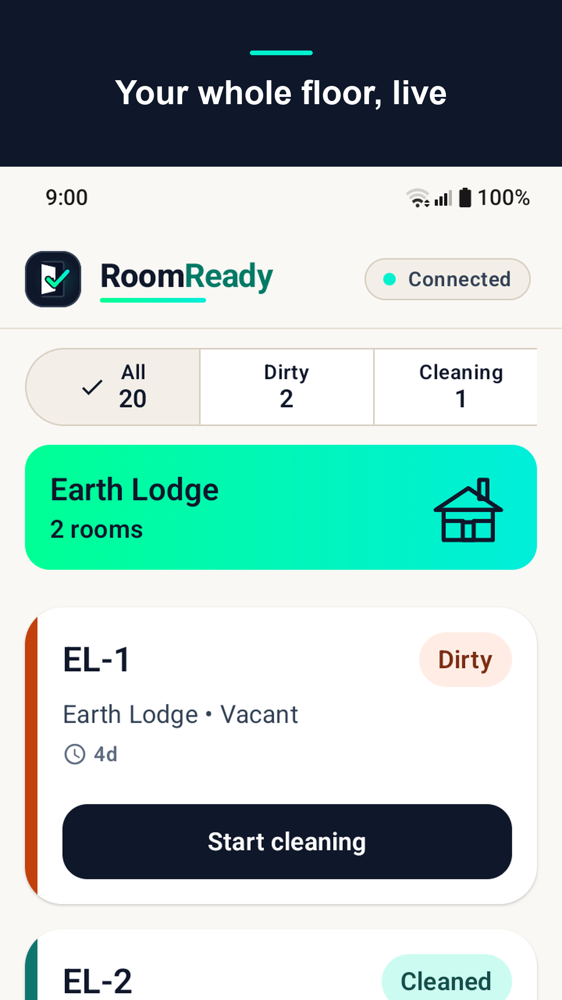
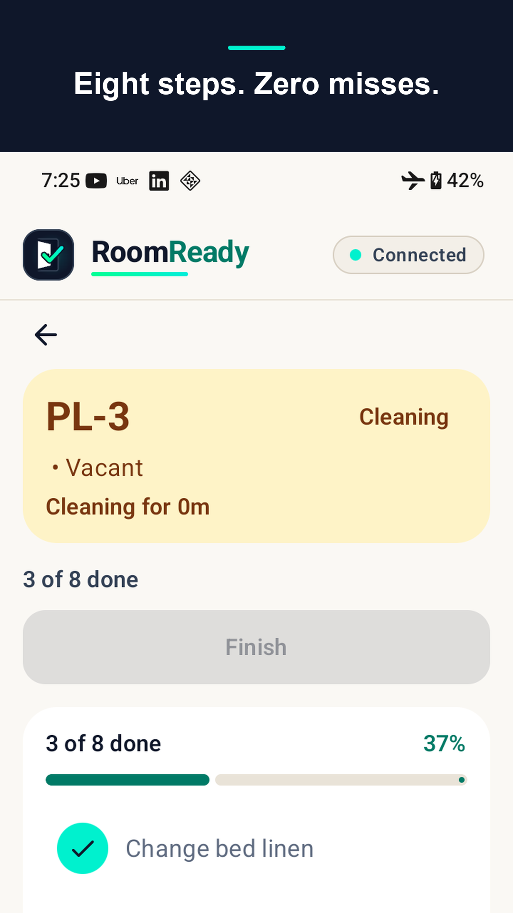
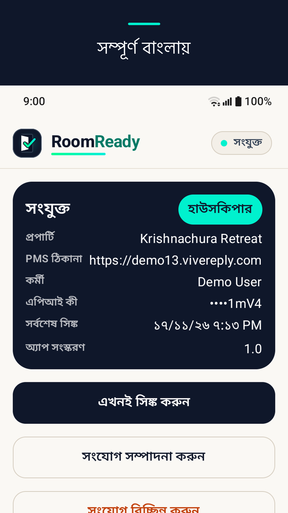

<p align="center">
  
</p>

# RoomReady

> *I remixed my own Yard #6 entry — RoomReady, an offline housekeeping web app — into a native Android app that syncs with a live resort PMS. Same soul, new body, and for the first time, a heartbeat.*

RoomReady is an offline-first native Android housekeeping companion built in Kotlin and Jetpack Compose for resort staff at properties like Krishnachura Retreat (`demo13`), enabling reliable room turnover workflows (`Dirty → Cleaning → Cleaned → Ready`), 8-step inspection checklists, and maintenance ticketing on lightweight 2 GB RAM devices with bilingual English and Bengali parity and encrypted PMS synchronization.

## The remix story

Yard #6 produced RoomReady as an offline housekeeping **web app**. For Yard #7 it was rebuilt as a **native Android app** against the same product contract: the same flow, the same 8-step checklist, the same offline-first soul — plus a live sync heartbeat with the resort PMS housekeeping API. Nothing about the PMS changed; the new body just learned to talk to it.

*The PMS is my existing production product; this Android app was built during Yard #7 week and syncs with the PMS housekeeping API.*

## Screenshots

Captured on-device from the real app on Krishnachura data (see [the screenshot runbook](playstore/screenshots/SCREENS.md)) and framed with ink captions via `playstore/screenshots/frame-shot.py`. Store assets live in [playstore/](playstore/): [Play Store listing copy](playstore/roomready_PlayStore_Details.md), [feature graphic](playstore/feature-graphic.png), [512 px icon](playstore/icon-512.png), and the [demo-video storyboard](playstore/demo-storyboard.md).

<table>
  <tr>
    <td align="center" width="20%"><br/><sub>Home</sub></td>
    <td align="center" width="20%"><br/><sub>Activity (Offline)</sub></td>
    <td align="center" width="20%"><br/><sub>Rooms</sub></td>
    <td align="center" width="20%"><br/><sub>Checklist</sub></td>
    <td align="center" width="20%"><br/><sub>Profile (বাংলা)</sub></td>
  </tr>
</table>

## Setup

Requirements: JDK 21, Android SDK (compileSdk 36.1), AGP 9.1.1.

```sh
# Unit tests
JAVA_HOME=/opt/homebrew/opt/openjdk@21 ANDROID_HOME=$HOME/Library/Android/sdk \
  sh gradlew :app:testDebugUnitTest

# Lint
JAVA_HOME=/opt/homebrew/opt/openjdk@21 ANDROID_HOME=$HOME/Library/Android/sdk \
  sh gradlew :app:lintDebug

# Release bundle (founder signs with the production keystore locally;
# never commit keystores or keystore.properties)
KEYSTORE_PATH=/path/to/upload.jks STORE_PASSWORD=… KEY_PASSWORD=… \
  sh gradlew :app:bundleRelease
```

First run is connect-first: enter the PMS address, property API key, and staff name (or scan the QR pairing code). See [VERIFICATION.md](VERIFICATION.md) for the full verification matrix and the live acceptance script.
